# MetroPulse

### Urban Mobility Intelligence, Demand Forecasting & Fleet Optimization System

MetroPulse is an end-to-end Data Science and Machine Learning project that analyzes urban transportation patterns using NYC Yellow Taxi trip data. It combines data engineering, exploratory data analysis, machine learning, geospatial analytics, explainable AI, and mathematical optimization to support data-driven urban mobility decisions.

## Project Overview

MetroPulse transforms large-scale taxi trip records into actionable mobility insights through demand forecasting, geographical hotspot analysis, and fair fleet allocation.

## Key Features

### 1. Urban Mobility Analytics
- Analysis of taxi trip patterns and travel demand.
- Hourly, daily, and weekday demand analysis.
- Identification of high-demand pickup locations.

### 2. Data Engineering and Feature Engineering
- Data cleaning and quality validation.
- Parquet-based data processing.
- Temporal feature extraction.
- Lag and rolling-window demand features.

### 3. Demand Forecasting
- Hourly taxi demand forecasting.
- Comparison of Linear Regression, Random Forest, Gradient Boosting, and Seasonal Naive models.
- Model evaluation using MAE, RMSE, and R².

### 4. Geospatial Analytics
- Taxi zone demand mapping.
- DBSCAN-based geographical clustering.
- Identification of pickup hotspots and spatial patterns.

### 5. Explainable AI
- SHAP-based feature importance analysis.
- Interpretation of the factors influencing demand predictions.

### 6. Fleet Optimization
- Integer Linear Programming using PuLP and the HiGHS solver.
- Maximin optimization objective to improve minimum demand coverage across zones.
- Analysis of vehicle allocation, served demand, unmet demand, and zone-level coverage.

### 7. Interactive Dashboard and API
- Interactive Streamlit dashboard with seven analytical pages.
- FastAPI backend for demand forecasting and fleet allocation data.
- API integration between the dashboard and backend.

## Technology Stack

- **Programming:** Python
- **Data Processing:** Pandas, NumPy, PyArrow, DuckDB
- **Machine Learning:** Scikit-learn, Statsmodels
- **Explainable AI:** SHAP
- **Geospatial Analysis:** GeoPandas, Folium
- **Visualization:** Matplotlib, Plotly
- **Optimization:** PuLP, HiGHS
- **Backend:** FastAPI, Uvicorn
- **Dashboard:** Streamlit
- **Testing:** Pytest

## Dataset

**NYC TLC Yellow Taxi Trip Records – January 2024**

Source: [NYC Taxi and Limousine Commission – Trip Record Data](https://www.nyc.gov/site/tlc/about/tlc-trip-record-data.page)

The project also uses NYC taxi zone geographical boundaries and the taxi zone lookup dataset.

The original and cleaned large Parquet datasets are not included in this GitHub repository. They must be obtained and prepared locally before reproducing the complete data-processing workflow.

## Model Performance

The selected Random Forest forecasting model achieved the following results on the January 2024 temporal test set:

| Metric | Result |
|---|---:|
| MAE | 269.405 |
| RMSE | 388.332 |
| R² | 0.9718 |

The model was evaluated on a rolling one-hour-ahead test period. Its performance should be interpreted within the scope of this dataset and evaluation period.

## Fleet Optimization Results

The fleet allocation simulation uses:
- 1,000 available vehicles.
- A capacity assumption of two trips per vehicle per hour.
- 258 active geographical taxi zones.
- Integer Linear Programming with a maximin fairness objective.

Key results:
- Minimum zone demand coverage: 39.97%.
- Average zone coverage: 84.64%.
- Overall demand-weighted coverage: 40.98%.

These are simulation results, not live vehicle dispatch or operational deployment results.

## Dashboard Pages

1. Overview
2. Demand Analytics
3. Demand Forecasting
4. Geospatial Insights
5. Model Explainability
6. Model Performance
7. Fleet Optimization

## Installation and Setup

### 1. Clone the repository

```bash
git clone <YOUR_GITHUB_REPOSITORY_URL>
cd MetroPulse
```

### 2. Create a virtual environment

```bash
python -m venv .venv
```

### 3. Activate the environment

Windows PowerShell:

```powershell
.\.venv\Scripts\Activate.ps1
```

### 4. Install dependencies

```bash
python -m pip install -r requirements.txt
```

### 5. Start the FastAPI backend

```bash
uvicorn app.main:app --app-dir backend --reload
```

Backend: http://127.0.0.1:8000

API documentation: http://127.0.0.1:8000/docs

### 6. Start the Streamlit dashboard

Open a second terminal, activate the same virtual environment, and run:

```bash
streamlit run frontend/dashboard.py
```

Dashboard: http://localhost:8501

## Running Tests

Run the backend API tests using:

```bash
python -m pytest tests/test_api.py -v
```

## Repository Structure

```text
MetroPulse/
│
├── backend/
│   └── app/
│       ├── main.py
│       └── services/
│
├── data/
│   ├── raw/
│   ├── processed/
│   └── external/
│
├── frontend/
│   └── dashboard.py
│
├── ml/
│   ├── artifacts/
│   ├── evaluation/
│   └──
│
├── reports/
│   └── figures/
│
├── src/
│   └── optimization/
│
├── tests/
│   └── test_api.py
│
├── requirements.txt
├── README.md
└── .gitignore
```

## Project Status

**Development completed — local implementation and integration verified.**

MetroPulse demonstrates an integrated Data Science workflow combining data processing, machine learning, geospatial analysis, explainability, mathematical optimization, API development, and interactive visualization.

## Developer

Data Science Project


## Dashboard Screenshots

### Dashboard Overview
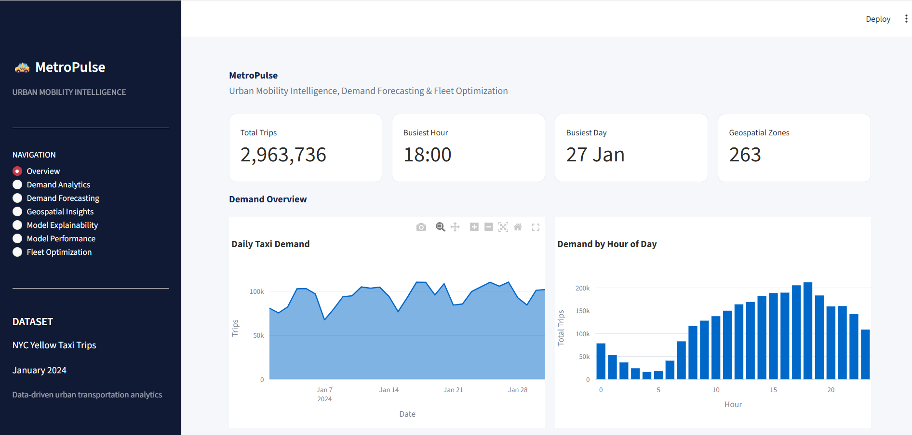

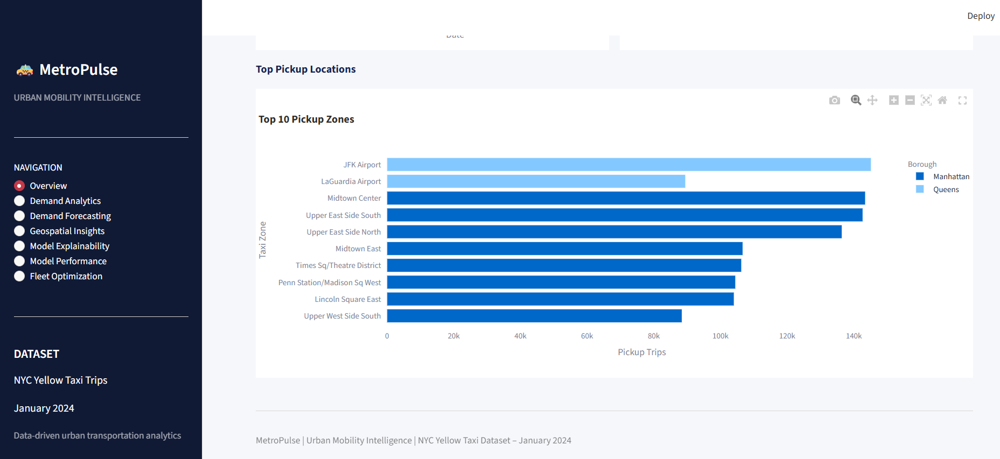

### Demand Forecasting


### Geospatial Analysis
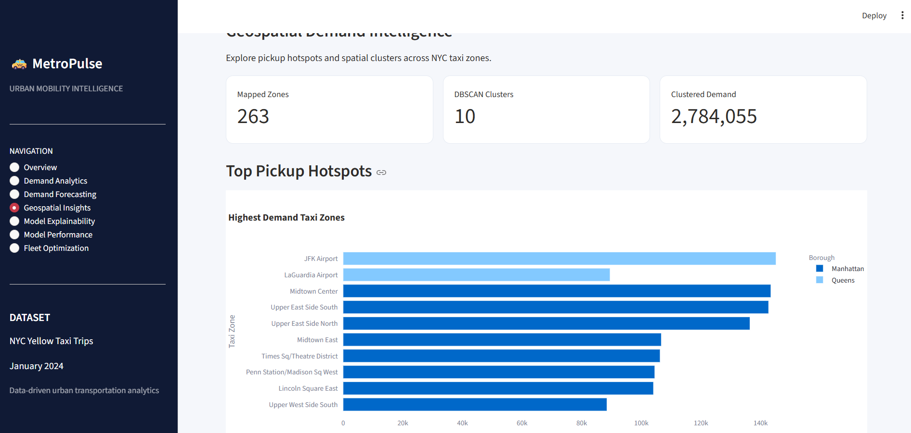

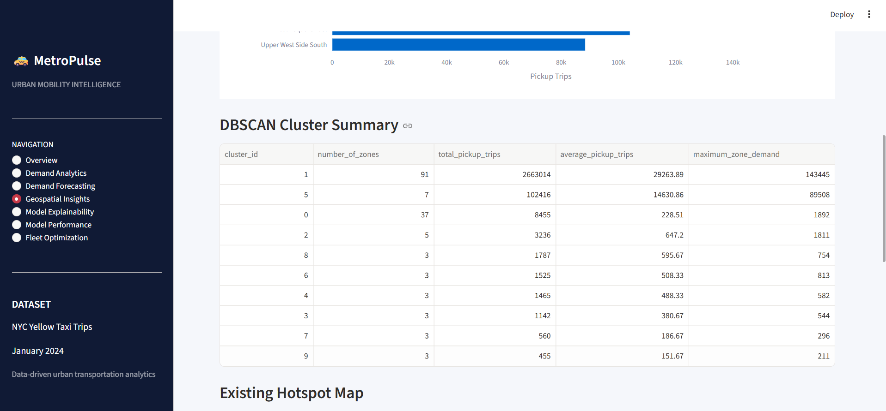

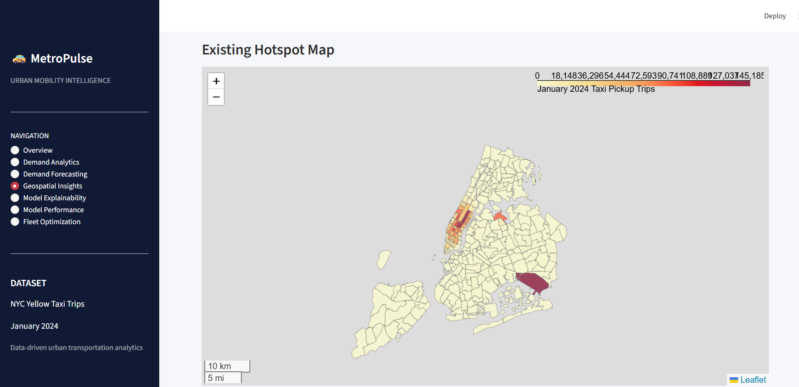

### SHAP Explainability
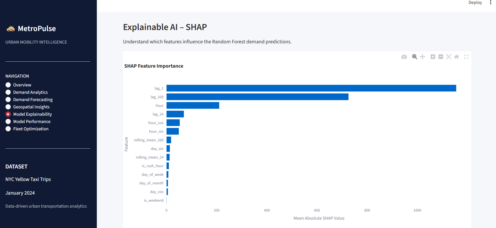

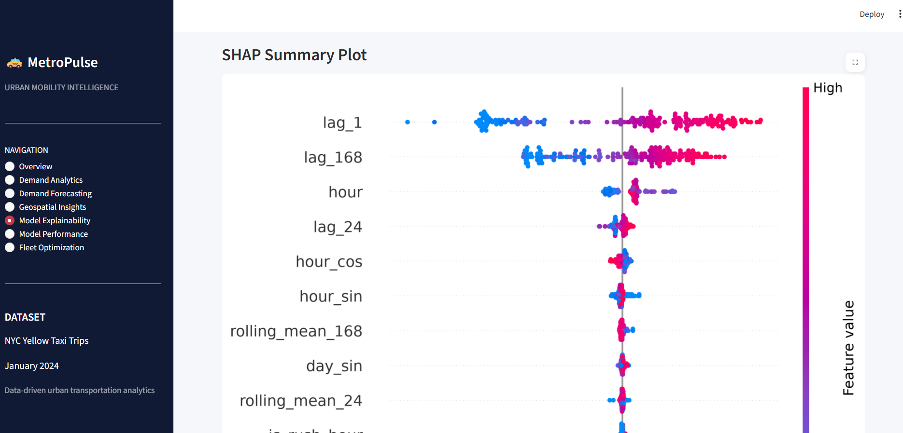

### Fleet Optimization
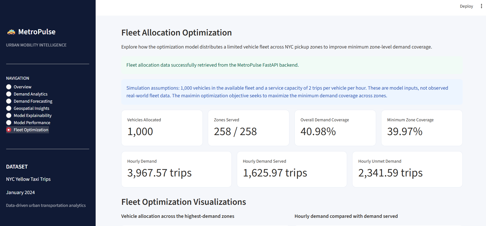

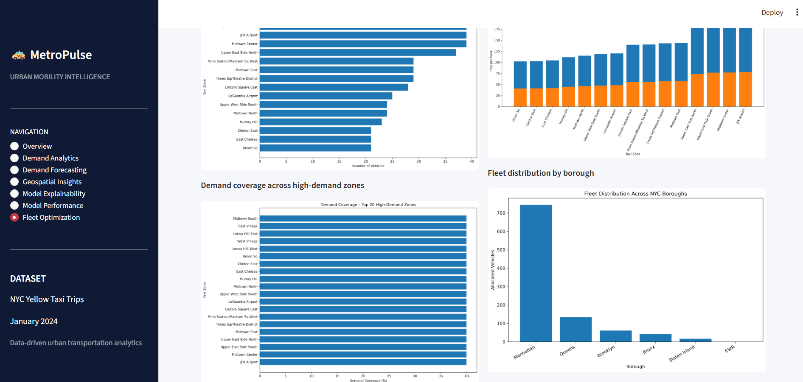

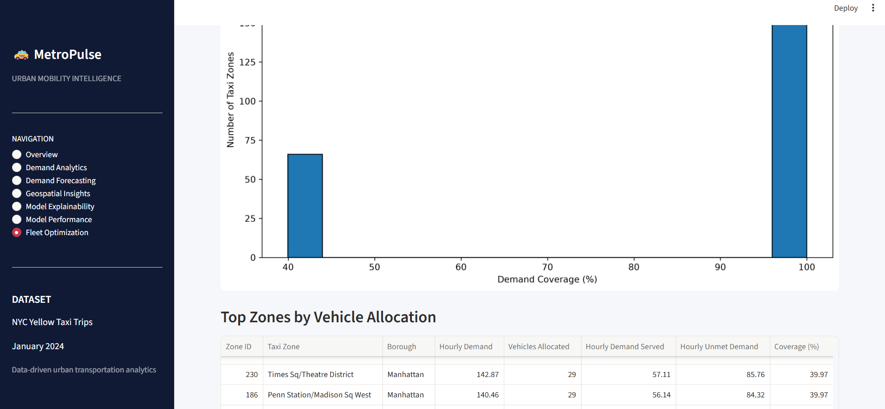


## System Architecture

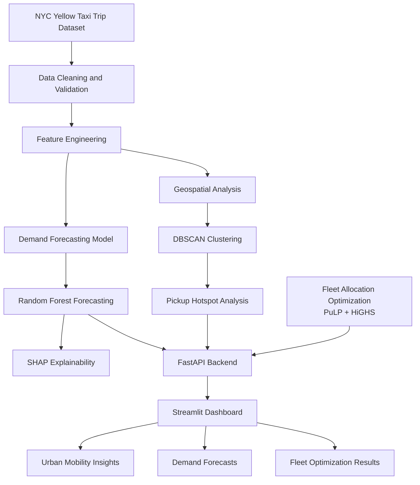
